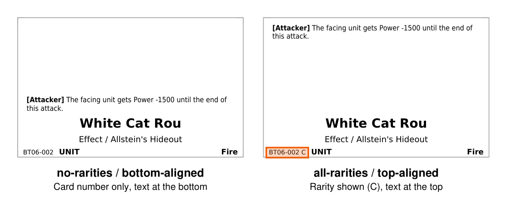

# Nivel Arena English card inserts

Printable English rules-text slips for Nivel Arena cards. Cut them out and slide them into the sleeve in front of the card.

   

## Printing

- Print on **A4** at **100 % scale** with "fit to page" **turned off**. Slips are 63 × 39 mm.
- Cut along the corner guides.
- Pick a rarity folder, then a text alignment. Every set is in all four combinations:
  `no-rarities/` or `all-rarities/`, each with `bottom-aligned/` and `top-aligned/`.

### What the folders mean

- **Rarity.** Some cards are printed more than once, in different rarities, with the
  same text. [`no-rarities/`](no-rarities) has one slip per card number.
  [`all-rarities/`](all-rarities) has one slip per printing, with the rarity next to the
  card number so you can match the slip to the exact card.
- **Alignment.** When the text doesn't fill the slip, it sits at the bottom in
  `bottom-aligned/`, as it does on the cards, or at the top in `top-aligned/`. Long text
  fills the slip either way.

The image at the top shows both choices on one card: `no-rarities` with `bottom-aligned`
text, and `all-rarities` with `top-aligned` text and the rarity highlighted.

## Sets

| Set | Name | Cards | No rarities | All rarities |
|:---:|:---:|:---:|:---:|:---:|
| BT09 | Indigo and Clear Skies | 81 | [bottom](no-rarities/bottom-aligned/BT09.pdf) / [top](no-rarities/top-aligned/BT09.pdf) | [bottom](all-rarities/bottom-aligned/BT09.pdf) / [top](all-rarities/top-aligned/BT09.pdf) |
| BT08 | Wave to You | 85 | [bottom](no-rarities/bottom-aligned/BT08.pdf) / [top](no-rarities/top-aligned/BT08.pdf) | [bottom](all-rarities/bottom-aligned/BT08.pdf) / [top](all-rarities/top-aligned/BT08.pdf) |
| BT07 | Eve Protocol | 88 | [bottom](no-rarities/bottom-aligned/BT07.pdf) / [top](no-rarities/top-aligned/BT07.pdf) | [bottom](all-rarities/bottom-aligned/BT07.pdf) / [top](all-rarities/top-aligned/BT07.pdf) |
| BT06 | Golden Tamago | 84 | [bottom](no-rarities/bottom-aligned/BT06.pdf) / [top](no-rarities/top-aligned/BT06.pdf) | [bottom](all-rarities/bottom-aligned/BT06.pdf) / [top](all-rarities/top-aligned/BT06.pdf) |
| BT05 | Matsuri | 86 | [bottom](no-rarities/bottom-aligned/BT05.pdf) / [top](no-rarities/top-aligned/BT05.pdf) | [bottom](all-rarities/bottom-aligned/BT05.pdf) / [top](all-rarities/top-aligned/BT05.pdf) |
| BT04 | Days of Bitter Cold | 84 | [bottom](no-rarities/bottom-aligned/BT04.pdf) / [top](no-rarities/top-aligned/BT04.pdf) | [bottom](all-rarities/bottom-aligned/BT04.pdf) / [top](all-rarities/top-aligned/BT04.pdf) |
| BT03 | Unbreakable | 85 | [bottom](no-rarities/bottom-aligned/BT03.pdf) / [top](no-rarities/top-aligned/BT03.pdf) | [bottom](all-rarities/bottom-aligned/BT03.pdf) / [top](all-rarities/top-aligned/BT03.pdf) |
| BT02 | The Kingdom | 81 | [bottom](no-rarities/bottom-aligned/BT02.pdf) / [top](no-rarities/top-aligned/BT02.pdf) | [bottom](all-rarities/bottom-aligned/BT02.pdf) / [top](all-rarities/top-aligned/BT02.pdf) |
| BT01 | Encounter | 81 | [bottom](no-rarities/bottom-aligned/BT01.pdf) / [top](no-rarities/top-aligned/BT01.pdf) | [bottom](all-rarities/bottom-aligned/BT01.pdf) / [top](all-rarities/top-aligned/BT01.pdf) |
| SB02 | Eternal Return | 65 | [bottom](no-rarities/bottom-aligned/SB02.pdf) / [top](no-rarities/top-aligned/SB02.pdf) | [bottom](all-rarities/bottom-aligned/SB02.pdf) / [top](all-rarities/top-aligned/SB02.pdf) |
| SB01 | Goddess of Victory: NIKKE | 60 | [bottom](no-rarities/bottom-aligned/SB01.pdf) / [top](no-rarities/top-aligned/SB01.pdf) | [bottom](all-rarities/bottom-aligned/SB01.pdf) / [top](all-rarities/top-aligned/SB01.pdf) |
| ST14 | Sisterhood | 17 | [bottom](no-rarities/bottom-aligned/ST14.pdf) / [top](no-rarities/top-aligned/ST14.pdf) | [bottom](all-rarities/bottom-aligned/ST14.pdf) / [top](all-rarities/top-aligned/ST14.pdf) |
| ST13 | Seminar | 17 | [bottom](no-rarities/bottom-aligned/ST13.pdf) / [top](no-rarities/top-aligned/ST13.pdf) | [bottom](all-rarities/bottom-aligned/ST13.pdf) / [top](all-rarities/top-aligned/ST13.pdf) |
| ST12 | Calamity Fox | 17 | [bottom](no-rarities/bottom-aligned/ST12.pdf) / [top](no-rarities/top-aligned/ST12.pdf) | [bottom](all-rarities/bottom-aligned/ST12.pdf) / [top](all-rarities/top-aligned/ST12.pdf) |
| ST11 | Cocytus | 17 | [bottom](no-rarities/bottom-aligned/ST11.pdf) / [top](no-rarities/top-aligned/ST11.pdf) | [bottom](all-rarities/bottom-aligned/ST11.pdf) / [top](all-rarities/top-aligned/ST11.pdf) |
| ST10 | Bayrun | 17 | [bottom](no-rarities/bottom-aligned/ST10.pdf) / [top](no-rarities/top-aligned/ST10.pdf) | [bottom](all-rarities/bottom-aligned/ST10.pdf) / [top](all-rarities/top-aligned/ST10.pdf) |
| ST09 | Tropical | 17 | [bottom](no-rarities/bottom-aligned/ST09.pdf) / [top](no-rarities/top-aligned/ST09.pdf) | [bottom](all-rarities/bottom-aligned/ST09.pdf) / [top](all-rarities/top-aligned/ST09.pdf) |
| ST08 | Anniversary | 17 | [bottom](no-rarities/bottom-aligned/ST08.pdf) / [top](no-rarities/top-aligned/ST08.pdf) | [bottom](all-rarities/bottom-aligned/ST08.pdf) / [top](all-rarities/top-aligned/ST08.pdf) |
| ST07 | Homunculus | 17 | [bottom](no-rarities/bottom-aligned/ST07.pdf) / [top](no-rarities/top-aligned/ST07.pdf) | [bottom](all-rarities/bottom-aligned/ST07.pdf) / [top](all-rarities/top-aligned/ST07.pdf) |
| ST06 | Successor | 17 | [bottom](no-rarities/bottom-aligned/ST06.pdf) / [top](no-rarities/top-aligned/ST06.pdf) | [bottom](all-rarities/bottom-aligned/ST06.pdf) / [top](all-rarities/top-aligned/ST06.pdf) |
| ST05 | Maid for You | 17 | [bottom](no-rarities/bottom-aligned/ST05.pdf) / [top](no-rarities/top-aligned/ST05.pdf) | [bottom](all-rarities/bottom-aligned/ST05.pdf) / [top](all-rarities/top-aligned/ST05.pdf) |
| ST04 | Inherit | 17 | [bottom](no-rarities/bottom-aligned/ST04.pdf) / [top](no-rarities/top-aligned/ST04.pdf) | [bottom](all-rarities/bottom-aligned/ST04.pdf) / [top](all-rarities/top-aligned/ST04.pdf) |
| ST03 | Heretic | 17 | [bottom](no-rarities/bottom-aligned/ST03.pdf) / [top](no-rarities/top-aligned/ST03.pdf) | [bottom](all-rarities/bottom-aligned/ST03.pdf) / [top](all-rarities/top-aligned/ST03.pdf) |
| ST02 | Real Kindness | 17 | [bottom](no-rarities/bottom-aligned/ST02.pdf) / [top](no-rarities/top-aligned/ST02.pdf) | [bottom](all-rarities/bottom-aligned/ST02.pdf) / [top](all-rarities/top-aligned/ST02.pdf) |
| ST01 | Counters | 17 | [bottom](no-rarities/bottom-aligned/ST01.pdf) / [top](no-rarities/top-aligned/ST01.pdf) | [bottom](all-rarities/bottom-aligned/ST01.pdf) / [top](all-rarities/top-aligned/ST01.pdf) |
| PR01 | Epic Seven | 12 | [bottom](no-rarities/bottom-aligned/PR01.pdf) / [top](no-rarities/top-aligned/PR01.pdf) | [bottom](all-rarities/bottom-aligned/PR01.pdf) / [top](all-rarities/top-aligned/PR01.pdf) |

## Credits

The translations come from [NivelTracker](https://niveltracker.com), made with Claude
and DeepL. The PDFs are shared here with the author's permission. Thank you to them
for the work behind every slip.

## Nivel Arena

Nivel Arena is a trading card game developed by Gemblo Company and published by
Daewon Media. This is an unofficial fan project. It is not affiliated with or endorsed
by either company. Card names, game text and artwork belong to their owners.

The PDFs are shared with the author's permission. They may be downloaded and printed for personal use. Redistributing or republishing them requires permission. The README and slip layouts are all rights reserved.

## Fonts

The slips use DejaVu Sans. Its licence is in [`NOTICE-fonts.txt`](NOTICE-fonts.txt).

## Corrections

- Translation mistakes: report them to [NivelTracker](https://niveltracker.com).
- Layout problems (text too small, cut off, misaligned): open an issue on this repository.

This repository is updated automatically.
